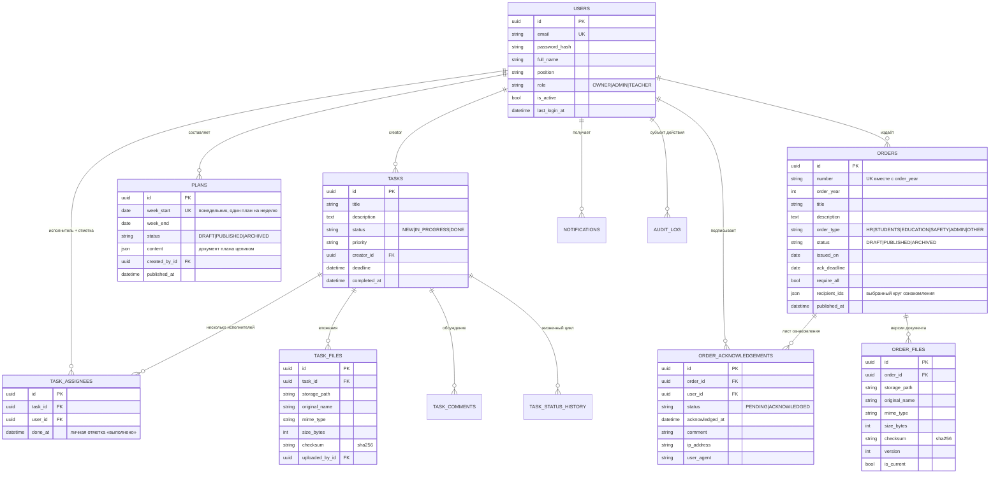

# Архитектура SchoolHub

Документ описывает модель данных, ключевые проектные решения (в формате лёгких ADR)
 и то, как реализовано разграничение доступа.

---

## 1. Общая схема

```
                        ┌─────────────────────────────────────────────┐
                        │                 Клиент (SPA)                │
                        │  React 18 + TS + TanStack Query + Router    │
                        │  ─────────────────────────────────────────  │
                        │  store/auth  ← JWT (access в памяти/session,│
                        │                refresh в localStorage)      │
                        │  lib/permissions ← capabilities из /auth/me │
                        └───────────────────┬─────────────────────────┘
                                            │ JSON / multipart / blob
                        ┌───────────────────▼─────────────────────────┐
                        │            nginx (prod) / vite (dev)        │
                        │   статика SPA + reverse-proxy /api → :8000  │
                        └───────────────────┬─────────────────────────┘
                                            │
┌───────────────────────────────────────────▼───────────────────────────────────────────┐
│                              FastAPI (uvicorn, async)                                  │
│                                                                                       │
│  api/       маршруты + RBAC-зависимости + сериализация (Pydantic)                     │
│    ├── auth.py       login / refresh / me / change-password / logout                  │
│    ├── users.py      справочник сотрудников, управление учётками                      │
│    ├── orders.py     приказы, файлы, ознакомление, CSV-экспорт                        │
│    ├── tasks.py      задачи, статусы, комментарии                                     │
│    └── misc.py       уведомления, аудит, дашборд, справочники                         │
│                                                                                       │
│  services/  бизнес-логика (не знает про HTTP)                                         │
│    ├── orders.py     жизненный цикл приказа, круг ознакомления, версии файлов         │
│    ├── tasks.py      scope-фильтры, state machine, вычисление OVERDUE                 │
│    ├── notifications.py  in-app события                                               │
│    ├── audit.py      журнал + diff                                                    │
│    ├── storage.py    FileStorage (локальная ФС, S3-ready), валидация MIME/размера     │
│    └── documents.py  отдача/превью, конвертация DOCX→PDF (LibreOffice, опц.)          │
│                                                                                       │
│  security.py      JWT, bcrypt, require_role(), get_current_user, client_meta()        │
│  capabilities.py  матрица «роль → возможности» (единый источник для API и UI)         │
│  models/ schemas/ enums.py types.py dbutils.py errors.py config.py                    │
└──────────────┬───────────────────────────────────────┬────────────────────────────────┘
               │ asyncpg                               │ файловая система
       ┌───────▼────────┐                    ┌─────────▼──────────┐
       │ PostgreSQL 16  │                    │ storage/uploads/   │
       │ (SQLite в CI)  │                    │  <yyyy>/<mm>/<uuid>│
       └────────────────┘                    └────────────────────┘
```

**Правило зависимостей:** `api → services → models`. Сервисы не импортируют `fastapi`
(кроме `UploadFile` как носителя байтов), роутеры не содержат бизнес-правил — только
проверки прав, маппинг параметров и сериализацию. Это позволяет переиспользовать сервисы
из CLI, планировщика и тестов.

---

## 2. Модель данных



Индексы: `users.email`, `orders(number, order_year)` (unique), `orders(issued_on, order_type, status)`,
`order_acknowledgements(order_id, user_id)` (unique), `task_assignees(task_id, user_id)` (unique),
`task_assignees(user_id)`, `tasks(status, deadline)`, `plans(week_start)` (unique), `plans(status)`,
`audit_log(action, entity_type, created_at)`, `notifications(user_id, is_read)`.

**План работы — JSON-документ, а не набор таблиц.** `plans.content` хранит документ целиком
(дежурство, блоки «в течение месяца/недели», мероприятия по дням с ответственными-UUID).
План всегда читается и пишется целиком и занимает ~40 строк в год, поэтому нормализация
не даёт выигрыша ни в запросах, ни в целостности; структура строго валидируется
Pydantic-схемами (`app/schemas/plan.py`), а ссылки на сотрудников проверяются сервисом
при каждом сохранении. Ответственные собираются обходом документа (`Plan.responsible_ids()`)
и используются для уведомлений при публикации и для счётчика «моих пунктов».

---

## 3. Ключевые решения (ADR)

### ADR-01. «Просрочена» — вычисляемое состояние, а не значение колонки

**Контекст.** ТЗ требует 4 статуса задачи: Новая, В работе, Выполнена, Просрочена.
Первые три — результат действия пользователя, четвёртый наступает **сам** по истечении срока.

**Проблема хранения.** Если `OVERDUE` писать в БД, данные устаревают без внешнего воздействия:
нужен cron/воркер, который каждые N минут переводит задачи в просрочку. Между тиками воркера
статус врёт, а при отказе воркера система «залипает».

**Решение.** В БД хранится только `NEW | IN_PROGRESS | DONE`, а просрочка вычисляется:

```python
def is_overdue(task, now):
    return bool(task.deadline and task.status != DONE and task.deadline < now)
```

* в SQL — предикатом (`deadline IS NOT NULL AND deadline < now AND status != 'DONE'`),
  поэтому фильтры и счётчики работают на стороне БД и корректно пагинируются;
* в API — полями `effective_status`, `is_overdue`, `days_left`;
* в UI — отдельной вкладкой/колонкой и красным бейджем.

**Следствие.** Статус всегда актуален, воркеры не нужны, переход «просрочена → выполнена»
не требует записи (достаточно `DONE`). Плата — чуть более сложный предикат в запросах
и правило «просроченная задача не учитывается в счётчиках NEW/IN_PROGRESS»
(иначе одна задача попадала бы в две вкладки).

---

### ADR-02. RBAC: декларативные зависимости + capabilities-контракт

**API.** Права объявляются в сигнатуре маршрута, поэтому проверка выполняется **до** бизнес-логики:

```python
router = APIRouter(prefix="/users", dependencies=[Depends(require_role(Role.ADMIN))])  # ADMIN и OWNER
ManagerDep = Annotated[User, Depends(require_role(Role.ADMIN))]                        # внутри orders/tasks

async def create_order(payload: OrderCreateIn, session: SessionDep, manager: ManagerDep): ...
```

`require_role(min_role)` использует иерархию `ROLE_LEVEL` (`TEACHER=1 < ADMIN=2 < OWNER=3`)
и сравнивает «не ниже», а не «равно» — частый источник багов в подобных гейтах.

Точечные правила, которые не описываются одной ролью, живут в сервисах и возвращают 403/409:

| Правило | Где |
|---|---|
| Учитель видит только свои задачи | `tasks.scope_filter()` — применяется и к списку, и к счётчикам, и к отчётам |
| Учитель не меняет исполнителя/дедлайн/приоритет | `tasks.update_task()` — whitelist полей |
| Комментировать могут только участники задачи | `tasks.add_comment()` |
| Подтвердить ознакомление может только участник круга | `orders.acknowledge()` |
| Издатель не входит в круг ознакомления | `orders._resolve_recipients()` |
| Нельзя выдать роль своего уровня и выше | `security.can_manage_role()` |
| Админ не видит и не редактирует Владельца | `users._visible_scope()` |
| В школе всегда ≥ 1 активного Владельца | `users.update_user()` |

**UI.** Сервер отдаёт в `GET /auth/me` список `capabilities` (строки вроде `orders:manage`),
а на клиенте `lib/permissions.ts` решает, какие разделы и кнопки показывать. Матрица доступна
через `GET /meta/permissions` и отображается в профиле — расхождение между UI и API исключено,
потому что источник один.

**Почему не таблицы `roles`/`permissions`.** Ролей три, они зафиксированы ТЗ, а проверки должны
быть дешёвыми и типизированными. Динамические права добавляются миграцией: таблица `permissions`
+ связь `role_permissions`, при этом словарь `capabilities` остаётся тем же контрактом для UI.

---

### ADR-03. Ознакомление как отдельная сущность (лист ознакомления)

Вместо флага «прочитано» на приказе создаётся строка `order_acknowledgements` на каждого
подписчика — это даёт:

* прогресс и список неподписавших без отдельных запросов;
* юридически значимый след: время, IP, User-Agent, комментарий;
* идемпотентность: `sync_acknowledgements()` приводит лист в соответствие с кругом
  (при смене списка удаляются только **неподписанные** строки — уже подтверждённые остаются как факт);
* повторное подтверждение отклоняется (409), «отозвать» подпись нельзя — только новый приказ.

Круг подписчиков формируется при публикации: `require_all=true` → все активные сотрудники,
кроме Владельца; иначе — явно переданный список `user_ids`. Издатель в круг не входит:
он подписал документ фактом издания.

---

### ADR-04. Файлы: версионирование и абстракция хранилища

* Путь в хранилище **генерирует сервер** (`<yyyy>/<mm>/<uuid>.<ext>`), клиентское имя файла
  используется только для отображения → исключены коллизии и path traversal
  (дополнительно `abspath()` проверяет, что итоговый путь лежит внутри корня).
* Загрузка нового файла не затирает старый, а создаёт версию (`version`, `is_current`),
  сохраняется sha256 — можно доказать, какой именно документ подписали сотрудники.
* Валидация: whitelist MIME (PDF/DOCX/DOC), лимит размера (потоково, с удалением огрызка),
  отказ на пустой файл.
* `FileStorage` — Protocol; `LocalFileStorage` реализован, `S3FileStorage` объявлен как точка
  расширения. Переход на MinIO/S3 не затрагивает сервисы и роутеры.
* Отдача файла — `FileResponse` с `Content-Disposition` (`inline` для PDF-превью,
  `attachment` для скачивания) и заголовком `X-Content-Type-Options: nosniff`.
  Клиент получает blob с заголовком `Authorization` (в `<iframe src>` заголовок не передать).

---

### ADR-05. Асинхронный стек и дисциплина загрузки связей

Весь путь от драйвера (`asyncpg`/`aiosqlite`) до роутеров — async. Из этого следует правило:
**никакой ленивой загрузки вне greenlet-контекста**. Практические следствия в коде:

* нужные связи объявлены как `lazy="selectin"` / `lazy="joined"`;
* после `flush()`/`refresh()` роутер явно перечитывает агрегат (`session.refresh(order)`),
  прежде чем сериализовать;
* CSV-экспорт строится **плоским** запросом с JOIN по конкретным колонкам: `FileResponse`
  стримится уже после возврата из хендлера, и ленивая подгрузка связи там недопустима.

---

### ADR-06. Портируемость между PostgreSQL и SQLite

Один и тот же код работает на PostgreSQL (prod) и SQLite (тесты, демо, быстрая разработка):

* `types.GUID` — UUID нативно в PG, `CHAR(36)` в SQLite;
* `types.EnumString` — enum хранится как VARCHAR, но в Python **всегда** возвращается
  экземпляр Enum (иначе возникает класс ошибок «то str, то Enum»);
* `JSONB().with_variant(JSON, "sqlite")` для аудита и payload уведомлений;
* `dbutils.ilike()` — в PG нативный `ILIKE` (Unicode-aware), в SQLite зарегистрированная
  SQL-функция `fold_lower` (встроенный `lower()` в SQLite не работает с кириллицей);
  при отсутствии функции — деградация до ASCII-поиска без падения запроса.

---

### ADR-07. Аудит и уведомления как побочные эффекты сервисов

Запись в `audit_log` и создание уведомлений выполняются в сервисах (не в роутерах), поэтому
их невозможно «забыть» при добавлении нового маршрута. Аудит хранит diff изменённых полей
`{field: {from, to}}`, субъекта, действие, сущность и IP. Уведомления — in-app; точка
расширения на e-mail/Telegram/WebPush обозначена в `services/notifications.py`
(вынос в брокер, чтобы не замедлять запрос).

---

### ADR-08. Аутентификация: короткий stateless access + серверные refresh-сессии

* Access (30 мин) + refresh (14 дней), различаются claim'ом `typ` — refresh нельзя предъявить
  как access и наоборот; каждый токен имеет `jti`.
* **Access-токен хранится только в памяти вкладки** (не в localStorage/sessionStorage):
  после перезагрузки сессия молча восстанавливается через `POST /auth/refresh`.
* **Refresh-токен — в httpOnly-cookie** (`SameSite=strict`, `Path=/api/v1/auth`,
  `Secure` включается `COOKIE_SECURE=true` за HTTPS-прокси). Документ не может её прочитать
  (XSS), а межсайтовый запрос её не отправит (CSRF); в теле ответов refresh больше не отдаётся.
* **Сессии отзываемы и ротируются** (`refresh_sessions`, см. `app/services/sessions.py`):
  одно семейство (`family_id`) на вход; каждый обмен выпускает новый `jti` и помечает старый
  `superseded_at`. Предъявление заменённого токена вне льготного окна (30 с — гонка
  параллельных вкладок) трактуется как кража: семейство отзывается целиком, в аудит пишется
  `TOKEN_REUSE_DETECTED`. Выход, смена/сброс пароля и блокировка отзывают сессии сразу
  (`revoked_at`), поэтому «refresh живёт ещё 14 дней после выхода» больше невозможно.
* Пароли — bcrypt через passlib (с пиннингом `bcrypt<4.1` из-за несовместимости API).
* Ошибка входа формулируется одинаково для «нет такого e-mail» и «неверный пароль»
  (защита от перебора по словарю e-mail), неудачные попытки пишутся в аудит.
* Заблокированный пользователь получает 403 даже с валидным access-токеном
  (`is_active` проверяется на каждом запросе) и 401 на refresh.

---

### ADR-09. Авторизация через Active Directory: bind вместо хранения паролей

**Контекст.** Школа работает в домене AD, NAS (Synology DS223) к домену присоединён.
Требуется вход под доменными учётками без отдельного пароля на каждое приложение.

**Варианты.**
1. *Kerberos/SPNEGO (настоящий SSO)* — тикет приходит из браузера. Требует keytab,
   SPN в AD, krb5-библиотеки в arm64-образе, настройки браузеров/прокси. Много
   эксплуатационных расходов при небольшой школе.
2. *LDAP bind* — приложение проверяет пароль bind'ом на контроллере домена.
3. *Хранить копии паролей* — недопустимо.

**Решение: вариант 2.** Пароль домена **нигде не сохраняется**: в БД лежит маркер
`password_hash = "!ldap"`, а локальная проверка пароля для таких учётке всегда
неуспешна. Последовательность входа:

```
логин (ivanov | ivanov@school.local | SCHOOL\ivanov)
  → валидация набора символов + экранирование для LDAP-фильтра
  → сервисная учётка (read-only): поиск DN и атрибутов пользователя
  → bind под учёткой пользователя с введённым паролем   ← фактическая проверка
  → проверка userAccountControl (не отключён) и белого списка групп AD
  → провижининг/синхронизация учётки SchoolHub
  → выдача JWT
```

**Разделение учётных данных.** Сервисная учётка (`LDAP_BIND_DN`) имеет только
`GenericRead` и нужна для поиска DN, чтения атрибутов и «Импорта из AD».
Пароль пользователя используется исключительно для bind'а и не логируется.

**Порядок проверки источника учётки.** Сначала смотрим на `auth_source` найденной
записи: если `local` — проверяем локальный пароль и **в каталог не обращаемся**.
Иначе локальную учётку можно было бы использовать как канал подбора доменных
паролей. Локальные учётки при этом сохраняются как break-glass на случай
недоступности DC.

**Провижининг и роли.** `LDAP_PROVISIONING=auto` — учётка создаётся при первом входе
любого пользователя домена (по требованию заказчика), роль — `LDAP_DEFAULT_ROLE`
(Учитель). Роли раздаёт Владелец в UI либо через группы AD (`LDAP_ADMIN_GROUPS`),
причём группы могут роль **только повышать**: понижение выполняется вручную.
Иначе исключение сотрудника из группы молча лишило бы его доступа к разделам
без записи в журнале и без ведома администратора.

**Переносимость.** Провайдер каталога описан интерфейсом `ADProvider`
(`authenticate` / `search_users` / `ping`), реализация `LdapADProvider` на `ldap3`
(чистый Python — собирается на arm64 без компиляторов). Все сетевые вызовы ldap3
синхронные, поэтому выполняются через `asyncio.to_thread`, не блокируя event loop.
Интерфейс позволяет тестировать весь сценарий входа на заглушке — так сделано в
`tests/test_ad_auth.py` (16 тестов без реального контроллера домена).

**Защита доменных учёток от блокировки.** Каждая неудачная попытка входа идёт в AD
и приближает срабатывание политики lockout. Поэтому добавлен локальный троттлинг
(`LOGIN_RATE_LIMIT` попыток за `LOGIN_RATE_WINDOW_MIN` минут, отдельно по учётке и
по IP) — перебор блокируется **до** обращения к контроллеру домена. Неудачные
попытки пишутся в журнал отдельной транзакцией (`write_audit_detached`), иначе
откат запроса с ошибкой 401 стирал бы след.

**Диагностируемость.** `GET /auth/ad/diagnostics` (OWNER/ADMIN) возвращает
конфигурацию без секретов, список проблем настройки и результат ping'а DC;
коды ошибок AD (`52e`, `533`, `775`, `532`…) переводятся в человекочитаемые
сообщения. Ошибки каталога отдают `503 AD_ERROR`, а не `401` — администратор
сразу отличает «неверный пароль» от «DC недоступен».

---

### ADR-10. Установка «без параметров»: автогенерация секретов и мастер настройки

**Контекст.** Целевая среда — школьный NAS (Synology DS223, ARM, 2 ГБ RAM), который
обслуживает не DevOps-инженер, а школьный системный администратор. Классический
«production-ready» запуск требовал: придумать `SECRET_KEY`, создать каталоги с нужными
правами, прописать DSN БД, решить, откуда возьётся первый администратор. Это много
шагов, на каждом из которых можно ошибиться, а ошибка с `SECRET_KEY` ещё и небезопасна
(соблазн скопировать пример из документации).

**Решение.** Обязательных параметров установки — **ноль**:

1. **`SECRET_KEY` генерируется при старте** (ENV → файл → автогенерация) и сохраняется
   в постоянном томе `secrets`, поэтому переживает пересоздание контейнера и не
   сбрасывает сессии пользователей. Задать свой ключ по-прежнему можно.
2. **Первый Владелец создаётся через веб-мастер.** До завершения настройки весь API
   отвечает `503 SETUP_REQUIRED`, доступны только `/health` и `/setup/*`.
   Для создания Владельца требуется **одноразовый код**, который генерируется при старте
   и печатается в журнал контейнера: получить его может только тот, у кого есть доступ
   к NAS (журнал в Container Manager или `docker logs`) — то есть фактически администратор
   сервера. После успешной настройки код стирается из БД, а повторный вызов даёт `409`.
3. **Альтернативный путь без браузера** — `python -m scripts.first_owner --email … --password …`
   (доступ к контейнеру сам по себе означает административный доступ, поэтому код не требуется).
4. **Данные в именованных томах Docker** (`dbdata`, `uploads`, `secrets`) — не нужно
   создавать каталоги и выставлять права вручную.
5. **Один публикуемый порт** (`HTTP_PORT`): backend и PostgreSQL наружу не видны,
   поэтому CORS и отдельные правила фаервола не требуются.

**Почему не «демо-учётка по умолчанию».** Учётка вида `admin/admin`, созданная автоматически,
— типовая причина взлома таких систем. Здесь же до создания Владельца приложение вообще
не пускает никого, а код настройки одноразовый и виден только администратору сервера.

**Побочный эффект.** Режим `AUTO_SEED=true` (демо-данные) остаётся для знакомства
с системой и разработки, но в боевом развёртывании выключен по умолчанию.

---

### ADR-11. Задачи: несколько исполнителей и личные отметки вместо «общего» статуса

**Контекст.** Школьная задача часто адресована нескольким сотрудникам сразу
(«оформить стенд», «подготовить кабинет»). При единственном исполнителе приходится
либо дублировать задачу, либо терять персональную ответственность. Общий статус
«Выполнена» при этом не отвечает на вопрос «кто именно сдал свою часть».

**Решение.** Связка «задача × исполнитель» вынесена в `task_assignees` с колонкой
`done_at` — личной отметкой «выполнено». Хранимый статус задачи остаётся общим,
но выводится из отметок детерминированно:

* отметился первый исполнитель → `IN_PROGRESS`;
* отметки есть у всех → `DONE` (в истории статуса фиксируется примечание
  «Все исполнители отметили «выполнено»»);
* снята отметка у закрытой задачи → откат в `IN_PROGRESS`.

Ручное управление статусом администрацией сохранено (state machine без изменений) —
отметки не «подделываются»: `done_at` ставится только самим исполнителем
(`POST /tasks/{id}/my-mark`, иначе `403`). Это разделение даёт и аудит: в журнале
событий видна каждая отметка (`TASK_MARK`) отдельно от ручных переходов (`TASK_STATUS`).

**Альтернативы.** Отдельные подзадачи (task per assignee) — избыточная сущность
для школьного масштаба; чек-лист внутри описания — не даёт ни уведомлений, ни отчётов.

---

## 4. Обработка ошибок

Единый контракт ошибки: `{"detail": "сообщение на русском", "code": "MACHINE_CODE"}`.

| Код HTTP | Когда |
|---|---|
| 400 | Неверные данные/файл (MIME, размер, пустой файл, некорректный период) |
| 401 | Нет/истёк/неверный токен, заблокированная учётка при входе |
| 403 | Недостаточно прав (роль или точечное правило) |
| 404 | Сущность не найдена |
| 409 | Конфликт: дубликат номера приказа, повторное ознакомление, недопустимый переход статуса, защита Владельца |
| 422 | Ошибка валидации Pydantic (сообщения собираются в человекочитаемую строку) |
| 500 | Неожиданная ошибка (логируется с трейсбеком, клиенту детали не отдаются) |

Бизнес-исключения (`AppError`) наследуют `HTTPException`, поэтому сервисы могут «бросать»
готовый HTTP-ответ, не зная о маршруте.

---

## 5. Производительность

* Пагинация везде (`limit/offset` + отдельный `count`), дефолт 20–50 строк.
* Фильтры строятся в SQL (а не пост-обработкой выборки), включая вычисляемую просрочку.
* `selectin` для коллекций (1 дополнительный запрос на коллекцию вместо N+1),
  `joined` для одиночных связей (`created_by`, `assignee`).
* Дебаунс поиска на клиенте (350 мс) и `staleTime` в TanStack Query снижают число запросов.
* Тяжёлые операции (конвертация DOCX→PDF) кэшируются рядом с файлом и выполняются один раз.
* Для роста: read-replica для отчётов, `pg_trgm`-индексы для полнотекстового поиска,
  курсорная пагинация вместо offset при больших объёмах.

---

## 6. Безопасность

* bcrypt для паролей, минимальная длина проверяется и в схеме, и в `hash_password`.
* JWT с `exp`/`iat`/`typ`/`jti`, секрет только из ENV.
* CORS по белому списку origin; в prod фронт и API на одном origin через nginx (CORS не нужен).
* Заголовки `X-Content-Type-Options: nosniff`, `X-Frame-Options: DENY`, `Referrer-Policy`.
* Загрузка файлов: whitelist MIME, лимит размера, серверные имена, проверка выхода за корень каталога.
* Защита от перебора: одинаковая формулировка ошибки входа + журнал неудачных попыток.
* Привилегии: контейнер backend'а работает под непривилегированным пользователем,
  БД и файлы — в именованных volume.
* Данные не удаляются физически там, где важна история: блокировка пользователя вместо удаления,
  архивирование приказа вместо удаления, версии файлов вместо перезаписи.
